# test_ebanking — envoi d'argent international

App Flutter d'envoi d'argent (remittance) pensée pour des téléphones Android modestes en 3G
instable. Le client se connecte par SMS, envoie un transfert et le suit jusqu'au paiement du
bénéficiaire. Un serveur simulé (Node + Express) reproduit les lenteurs, coupures et erreurs
d'un vrai réseau.

Ce que l'app garantit :

- **Jamais de double envoi involontaire**, même si l'app est tuée juste après « Envoyer » ou si
  le serveur répond après 30 s, ou jamais.
- **Historique hors ligne**, avec l'heure de sa dernière mise à jour.
- **Données du téléphone chiffrées** : base SQLCipher, clé et session dans le Keystore Android
  (Keychain sur iOS).
- **Session complète** : code SMS une fois, puis code secret ; renouvellement silencieux ;
  déconnexion qui efface tout ; révocation à distance si le téléphone est volé.
- **Notifications FCM** à chaque changement de statut, app ouverte, en arrière-plan ou fermée ;
  un appui ouvre le transfert concerné.

Stack : Flutter 3.47 (Dart 3), Riverpod 3 sans génération de code, Dio, Drift + SQLCipher,
flutter_secure_storage, go_router, firebase_messaging, local_auth. 

**Vidéo de démonstration** (2 min 34, émulateur Android) :
[à regarder sur Google Drive](https://drive.google.com/file/d/1WrCsaJ-MB3LBJ1DwSlpOFV33azGud8xy/view?usp=sharing),
ou le fichier [`docs/demo.mp4`](docs/demo.mp4) du dépôt.
Connexion, envoi et notifications, app tuée juste après « Confirmer », serveur qui répond après
30 s, session expirée, notification avec l'app fermée, téléphone volé.

### Captures


| Connexion | Accueil | Récapitulatif | Transfert envoyé | Bandeau, app ouverte |
|:-:|:-:|:-:|:-:|:-:|
| 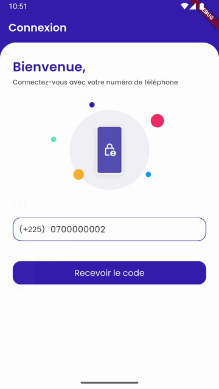 | 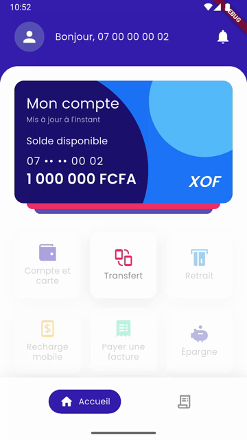 | 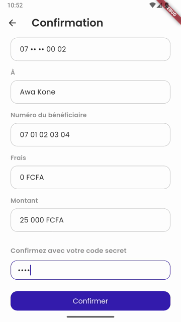 | 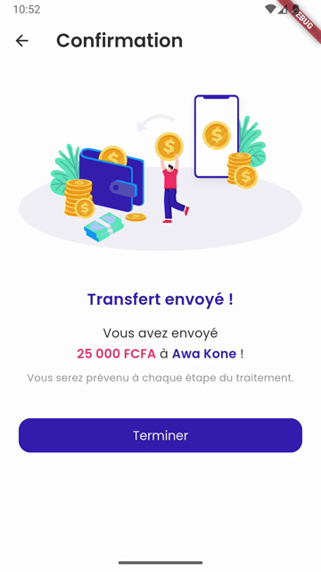 | 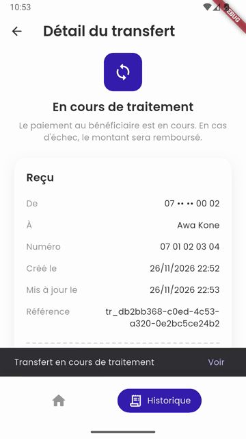 |

| Notification système | Historique hors ligne | Vérification en cours | Serveur lent | Session révoquée |
|:-:|:-:|:-:|:-:|:-:|
| 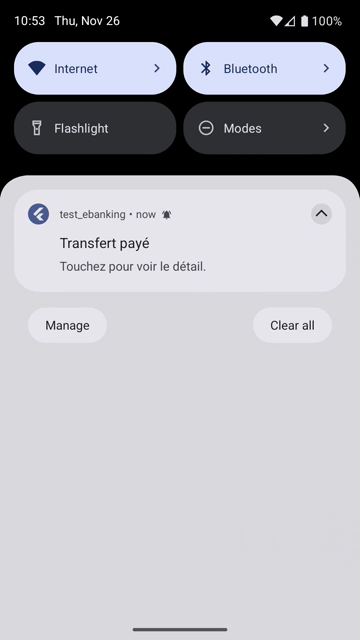 | 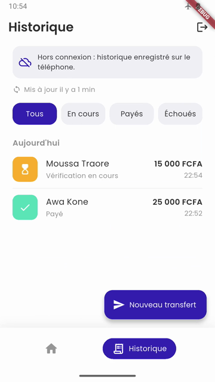 | 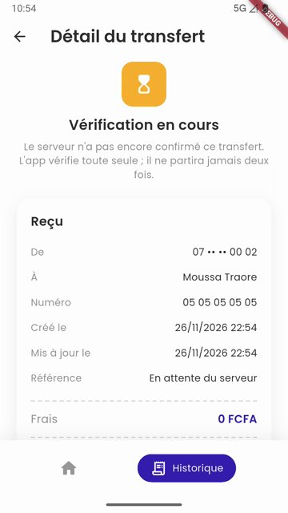 | 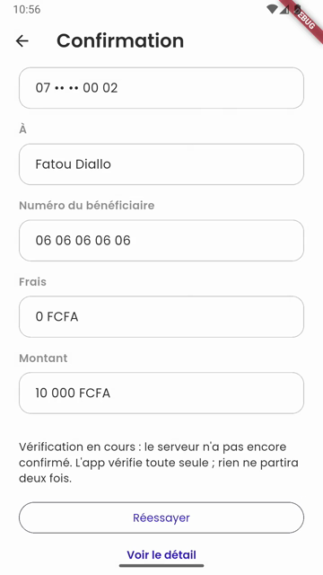 | 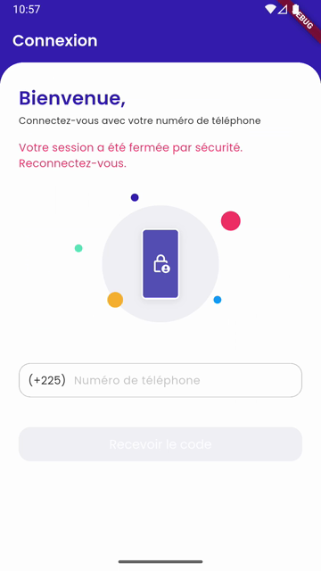 |

## Sommaire

- [Lancer le projet](#lancer-le-projet)
- [Architecture et frontières](#architecture-et-frontières)
- [Gestion d'état](#gestion-détat)
- [Envoyer sans jamais envoyer deux fois](#envoyer-sans-jamais-envoyer-deux-fois)
- [Connexion et session](#connexion-et-session)
- [Stockage sur le téléphone](#stockage-sur-le-téléphone)
- [Notifications (FCM)](#notifications-fcm)
- [Choix et alternatives écartées](#choix-et-alternatives-écartées)
- [Risques identifiés et réponses](#risques-identifiés-et-réponses)
- [Tests](#tests)
- [Ce qui a été testé sur appareil](#ce-qui-a-été-testé-sur-appareil)
- [Limites connues](#limites-connues)
- [Ce qui manque et comment je le ferais](#ce-qui-manque-et-comment-je-le-ferais)

## Lancer le projet

### Prérequis

- Flutter 3.47 ou plus récent (Dart 3) ;
- Node.js 18 ou plus récent, pour le serveur simulé ;
- un téléphone Android branché en USB (débogage USB activé), un émulateur Android ou le
  simulateur iOS ;
- pour envoyer des notifications : la clé du compte de service Firebase dans
  `mock_server/service-account.json` (voir [Notifications](#notifications-fcm)). Sans elle,
  tout le reste fonctionne.

### 1. Serveur simulé

```bash
cd mock_server
npm install        # la première fois
npm start          # http://localhost:3000
```

Le serveur garde tout en mémoire : le redémarrer efface comptes, transferts et sessions (l'app
demande alors de se reconnecter).

### 2. App

L'adresse du serveur est compilée dans l'app (`--dart-define=API_BASE_URL`, par défaut
`http://localhost:3000`).

| Appareil | Commande |
|---|---|
| Simulateur iOS | `flutter run` |
| Émulateur Android ou téléphone en USB | `adb reverse tcp:3000 tcp:3000` puis `flutter run` |
| Téléphone en Wi-Fi seulement | `flutter run --dart-define=API_BASE_URL=http://<ip-du-mac>:3000` |

`adb reverse` fait de `localhost:3000` sur le téléphone le port 3000 du Mac. Elle se perd à
chaque débranchement : il faut la relancer. Le HTTP en clair n'est autorisé qu'en debug
(`android/app/src/debug/AndroidManifest.xml`).

### 3. Se connecter

1. Saisir un numéro à 10 chiffres (par exemple `0700000001`).
2. Le code SMS s'affiche dans la console du serveur (ou `GET /admin/otp?phone=0700000001`).
3. Choisir un code secret à 4 chiffres.

Chaque numéro ouvre un compte de 1 000 000 FCFA.

### 4. Vérifier

```bash
flutter analyze
flutter test                                         # tests unitaires et de widgets
flutter test --tags integration --run-skipped        # contre le serveur simulé (localhost:3000)
```

Les tests d'intégration remettent le serveur à zéro. Pour garder celui de la démo, lancer un
second serveur et le viser :

```bash
cd mock_server && PORT=3100 npm start
MOCK_SERVER_URL=http://localhost:3100 flutter test --tags integration --run-skipped
```

### 5. Scénarios de démonstration

Toutes les commandes visent le serveur lancé sur `localhost:3000`.

| Scénario | Commande |
|---|---|
| Idempotence et chaque panne, pas à pas | `cd mock_server && ./try.sh` |
| Faire avancer le dernier transfert (→ notification) | `cd mock_server && ./advance.sh` |
| Faire échouer un transfert (remboursé) | `cd mock_server && STATUS=FAILED ./advance.sh` |
| Réponse perdue après création | `curl -X POST localhost:3000/admin/chaos -H 'Content-Type: application/json' -d '{"mode":"drop","count":1}'` |
| Serveur qui répond après 30 s | même commande avec `"mode":"slow"` |
| Serveur qui ne répond jamais | même commande avec `"mode":"hang"` |
| Coupure avant traitement | même commande avec `"mode":"down"` |
| Réseau instable (latence, 10 % d'erreurs 500, 5 % de coupures) | même commande avec `"mode":"random"`, sans `count` |
| Session expirée en pleine utilisation | `curl -X POST localhost:3000/admin/sessions/expire` |
| Téléphone volé (révocation par le support) | `curl -X POST localhost:3000/admin/sessions/revoke -H 'Content-Type: application/json' -d '{"phone":"0700000001"}'` |
| Recréditer un compte | `curl -X POST localhost:3000/admin/accounts/credit -H 'Content-Type: application/json' -d '{"phone":"0700000001","amount":500000}'` |
| Tout remettre à zéro | `curl -X POST localhost:3000/admin/reset` |
| Montrer que les données du téléphone sont illisibles hors de l'app | `./tool/show_phone_storage.sh "Nom d'un bénéficiaire"` |

`count` limite une panne aux N prochaines requêtes. Les routes `/admin` ne subissent jamais
de panne.

## Architecture et frontières

Clean Architecture en trois couches, rangées par fonctionnalité. Toutes les dépendances
pointent vers le domaine.

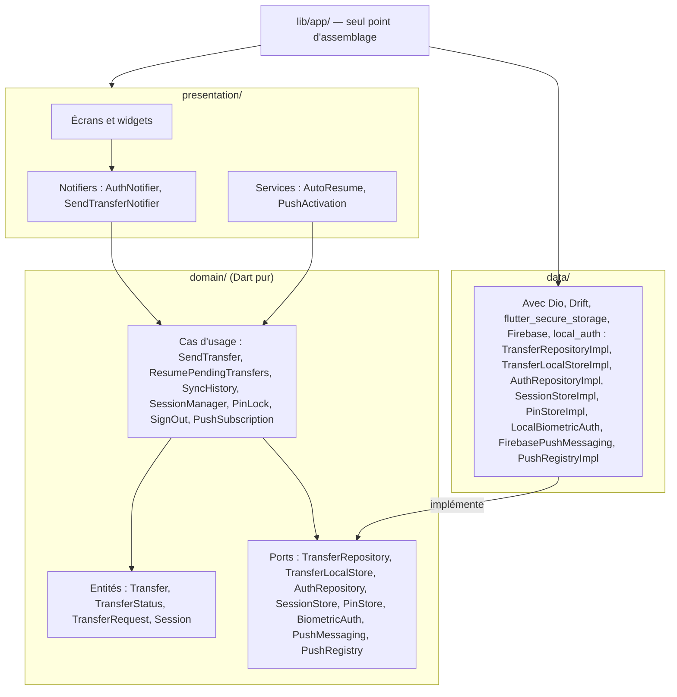

**Frontières**, vérifiées par [`test/architecture_test.dart`](test/architecture_test.dart), qui
lit les `import` et `export` de chaque fichier de `lib/` :

1. `domain/` est du Dart pur : il n'importe ni Flutter, ni Dio, ni Drift, ni
   flutter_secure_storage, ni Firebase, ni un fichier `data/` ou `presentation/`.
2. `domain/` déclare les **ports** (interfaces) ; `data/` les implémente.
3. `presentation/` ne connaît que le domaine, jamais `data/`.
4. `lib/app/` est le seul endroit qui branche les implémentations sur les ports.
5. Les erreurs attendues (saisie, réseau, refus du serveur) sont des valeurs (`Result`,
   `Failure`), pas des exceptions qui traversent les couches.
6. L'heure et les identifiants passent par `Clock` et `IdGenerator`, remplaçables en test.

Le serveur, la base locale et Riverpod sont donc des détails : les tests du domaine tournent
avec des faux écrits à la main, sans Flutter ni réseau.

**Le même cas d'usage avec ou sans réseau.** `SendTransfer` enregistre toujours le transfert
dans la base locale avant d'appeler le serveur. Sans réseau, l'appel échoue, le transfert reste
« Vérification en cours » et la reprise automatique le terminera. L'historique est toujours lu
dans la base locale ; le serveur ne fait que la mettre à jour quand il répond.

```
lib/
  core/                 Result, Failure, Clock, IdGenerator, config
    data/               createDio, conversion des erreurs Dio en Failure
    presentation/       thème, couleurs du kit, barre du bas
  features/
    transfer/           domain/ (entités, ports, cas d'usage), data/ (API, base chiffrée), presentation/
    auth/               connexion, session, code secret, empreinte
    push/               notifications FCM
  app/                  app.dart, router.dart, providers.dart (assemblage)
  main.dart
test/                   même arborescence que lib/, plus integration/
mock_server/            serveur simulé : server.js (contrat d'API), auth.js, accounts.js, chaos.js, push.js
tool/                   show_phone_storage.sh
```

## Gestion d'état

Riverpod 3, sans génération de code : chaque provider se lit tel qu'il est écrit.

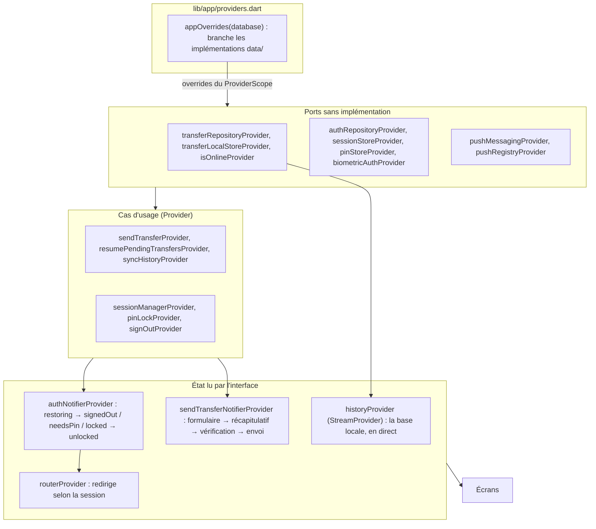

- **Injection** : les ports sont déclarés dans `presentation/*_providers.dart` sans
  implémentation. `lib/app/providers.dart` les remplace dans les `overrides` du
  `ProviderScope` ; les tests y branchent des faux.
- **Historique** : `historyProvider` écoute la base Drift. Une synchro, une reprise ou une
  notification met à jour la base, et tous les écrans se redessinent seuls.
- **Formulaire d'envoi** : `SendTransferNotifier` n'a pas d'`autoDispose`, pour que quitter
  l'écran ne crée pas une nouvelle clé d'idempotence. La clé est figée dès qu'un transfert est
  enregistré.
- **Services toujours actifs** : `App` garde vivants `autoResumeProvider` (reprise
  automatique) et `pushActivationProvider` (inscription aux notifications), déclenchés par
  `ref.listen` quand la session change.

## Envoyer sans jamais envoyer deux fois

Chaque transfert a une **clé d'idempotence** (UUID v4), créée une seule fois par formulaire et
envoyée dans l'en-tête `Idempotency-Key`. Le serveur reconnaît une clé déjà vue et renvoie le
transfert existant au lieu d'en créer un second.

Les règles, toutes couvertes par des tests :

1. **Une clé par intention d'envoi**, réutilisée pour « Réessayer » et pour toutes les reprises.
   Le domaine n'en fabrique jamais : `SendTransfer` la reçoit de l'appelant.
2. **Saisie invalide** (ou envoi à son propre numéro) : rien n'est écrit, aucun appel réseau.
3. **Écrire avant d'appeler** : le transfert est enregistré en `pendingSubmission` avant tout
   appel réseau. Si l'app est tuée pendant l'envoi, la reprise le retrouvera.
4. **Pas de réponse n'est pas un échec** : coupure, délai dépassé ou erreur 5xx donnent
   `unknownOutcome`, affiché « Vérification en cours », jamais « Échoué ». Le serveur a peut-être
   créé le transfert.
5. **Seul un refus 4xx est un refus** (`rejected`, final).
6. **La reprise demande avant de renvoyer** : `GET /transfers?idempotencyKey=` ; trouvé → mise à
   jour locale sans renvoi ; inconnu (404) → même requête, même clé, même contenu.
7. **Une seule façon d'envoyer** : `TransferSender`, partagé par `SendTransfer` et
   `ResumePendingTransfers`.
8. `connectivity_plus` déclenche la reprise mais ne décide jamais : seul le serveur dit si un
   transfert existe.

La reprise automatique (`AutoResume`) tourne au démarrage, au retour du réseau, au retour au
premier plan, à l'arrivée d'une notification, après un envoi accepté, puis toutes les 30 s tant
qu'un transfert est incertain. Un seul passage à la fois.

### Diagramme de séquence : app tuée pendant l'envoi, puis rouverte

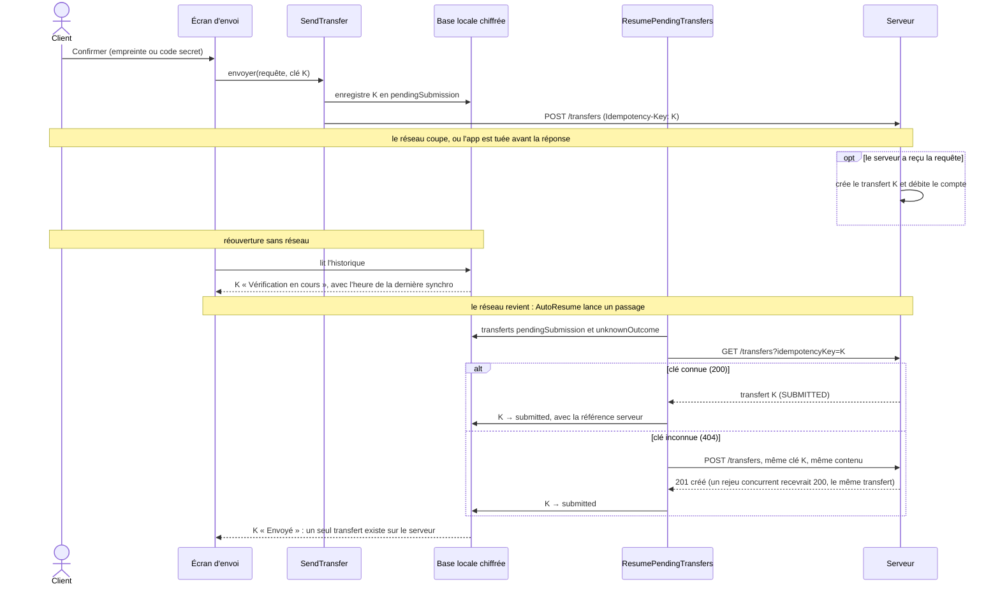

### Ce que voit le client dans chaque panne

| Situation | Sur le téléphone | Ce que fait la reprise | Sur le serveur |
|---|---|---|---|
| App tuée juste après « Envoyer » | `pendingSubmission`, écrit avant l'appel | cherche la clé, puis met à jour ou renvoie | 1 transfert |
| Réponse perdue après création (`drop`) | « Vérification en cours » | clé trouvée → mise à jour, sans renvoi | 1 transfert |
| Coupure avant traitement (`down`) | « Vérification en cours » | 404 → renvoi avec la même clé | 1 transfert |
| Serveur qui répond après 30 s (`slow`) ou jamais (`hang`) | « Vérification en cours » après 20 s sans réponse | clé trouvée → mise à jour | 1 transfert |
| Erreur 5xx | « Vérification en cours » | selon la clé : mise à jour ou renvoi | 1 transfert |
| Double appui ou « Réessayer » | même clé, déjà en base | réconcilie au lieu de recréer | 1 transfert |
| Solde insuffisant ou autre refus 4xx | « Refusé », rien n'a été débité | rien | 0 transfert |

Délais Dio : 10 s pour se connecter, 20 s pour recevoir. Assez long pour une 3G lente ;
au-delà, la reprise prend le relais sans risque de doublon.

## Connexion et session

Le parcours suit celui des apps de mobile money de la région : numéro et code SMS à
l'inscription, puis un code secret à 4 chiffres pour ouvrir l'app et pour valider chaque
paiement.

1. **Connexion** : numéro (`POST /auth/otp`), puis code SMS à 6 chiffres
   (`POST /auth/token`). Le serveur renvoie un jeton d'accès (5 min, gardé en mémoire seulement)
   et un jeton de renouvellement (gardé chiffré, à usage unique).
2. **Code secret** à 4 chiffres, créé juste après. Il est vérifié sur le téléphone, pour que
   l'historique s'ouvre en mode avion.
3. **Maintien** : code secret à chaque ouverture et au retour après 1 min en arrière-plan.
4. **Chaque envoi** est validé par l'empreinte (`local_auth`, sans repli sur le code du
   téléphone) ou, à défaut, par le code secret de l'app.
5. **Expiration et renouvellement** : sur un 401, `AuthInterceptor` demande un nouveau jeton à
   `SessionManager`, puis rejoue la requête une fois, avec la même `Idempotency-Key`. Un 401
   arrive avant tout traitement : rien n'a été créé. Un seul renouvellement à la fois, car un
   jeton de renouvellement réutilisé fait révoquer la session. Le client ne voit rien.
6. **Déconnexion** (`SignOut`) : transferts, code secret, inscription aux notifications et
   session sont effacés du téléphone d'abord (même hors ligne), puis la session est révoquée sur
   le serveur.
7. **5 codes secrets faux** : tout est effacé, retour à la connexion par SMS.

**Téléphone perdu ou volé déverrouillé.** Si l'app est ouverte, le voleur voit l'historique.
Il ne peut **rien envoyer** sans l'empreinte du client ou le code secret. Dès 1 min en
arrière-plan, l'app redemande le code secret, et 5 essais ratés effacent tout. Le client
appelle le support, qui révoque la session (`POST /admin/sessions/revoke`). Au renouvellement
suivant, l'app efface tout ce qu'elle garde et affiche un message ; le serveur n'envoie plus de
notification à ce téléphone, car l'inscription est rattachée à la session.

## Stockage sur le téléphone

`flutter_secure_storage` s'appuie sur le Keystore Android et le Keychain iOS : les valeurs y
sont chiffrées par une clé que le système ne laisse jamais sortir du téléphone.

| Donnée | Où | Forme | Pourquoi |
|---|---|---|---|
| Transferts (à envoyer et historique) | base SQLite chiffrée par SQLCipher (`files/transfers.sqlite`) | requête exacte gardée pour un rejeu identique | historique hors ligne, reprise après un redémarrage |
| Dernier solde connu et heure de synchro | même base (table `sync_state`) | entier en FCFA, date en secondes Unix | afficher « mis à jour il y a X min » hors ligne |
| Clé de la base | flutter_secure_storage (`transfer_database_key`) | 32 octets aléatoires, en hexadécimal | créée au premier lancement, jamais sur le serveur |
| Numéro et jeton de renouvellement | flutter_secure_storage (`session`) | JSON | rouvrir l'app sans refaire le SMS |
| Jeton d'accès | mémoire seulement | — | ne dure que 5 min, jamais écrit sur le disque |
| Code secret | flutter_secure_storage (`pin_hash`, `pin_salt`) | empreinte SHA-256 avec un sel de 16 octets | vérifier le code sans le garder |
| Essais ratés | flutter_secure_storage (`pin_failed_attempts`) | compteur | effacer tout au 5ᵉ essai, même si l'app est relancée |

**Le montrer.** `./tool/show_phone_storage.sh "Awa Kone"` (app debug, téléphone branché)
copie ces fichiers sur le Mac et essaie de les lire : la base ne commence pas par
`SQLite format 3`, `sqlite3` répond « file is not a database », et le nom du bénéficiaire est
introuvable. Les valeurs du stockage sécurisé sont chiffrées. Le test
[`transfer_database_test.dart`](test/features/transfer/data/local/transfer_database_test.dart)
prouve la même chose à chaque `flutter test`, y compris qu'une mauvaise clé n'ouvre pas la
base.

Pour lire la base en clair pendant le développement : l'onglet « drift » de DevTools passe par
la connexion déjà ouverte par l'app, sans sortir la clé. Ce code n'existe pas dans une version
release.

## Notifications (FCM)

- **Inscription** : dès qu'une session est ouverte, l'app demande la permission puis envoie son
  identifiant d'installation Firebase (FID, `firebase_messaging` 17 ; `getToken` est déprécié)
  au serveur (`POST /devices`), qui le rattache à la session. Si le serveur était injoignable au
  démarrage, l'inscription est refaite après la première synchro réussie.
- **Envoi** : `POST /admin/transfers/:id/advance` (ou `./advance.sh`) fait avancer le statut ;
  `mock_server/push.js` appelle l'API HTTP v1 de FCM, authentifié par le compte de service.
- **Réception** : app fermée ou en arrière-plan, le système affiche la notification et l'appui
  ouvre `/transfers/<clé>` après le déverrouillage. App ouverte : un bandeau « Voir » et une
  synchro immédiate.
- **Texte neutre** (ni montant ni bénéficiaire), car il s'affiche sur l'écran verrouillé.
- Une notification n'est qu'un **déclencheur** : le statut affiché vient toujours du serveur,
  car une notification peut arriver en retard, en double ou pas du tout.

**Configurer l'envoi.** Dans la console Firebase du projet : Paramètres du projet → Comptes de
service → Générer une nouvelle clé privée, enregistrée sous `mock_server/service-account.json`.
Ce fichier est ignoré par Git et ne doit jamais être commité. Pour utiliser votre propre
projet Firebase : `flutterfire configure`, qui régénère `lib/firebase_options.dart`,
`android/app/google-services.json` et `ios/Runner/GoogleService-Info.plist`.

## Choix et alternatives écartées

| Choix | Alternative écartée | Pourquoi |
|---|---|---|
| Clé d'idempotence créée sur le téléphone | identifiant donné par le serveur | elle doit exister avant le premier appel pour survivre à une coupure |
| `unknownOutcome` + reprise qui demande d'abord | afficher « Échoué » après un délai | le serveur a peut-être créé le transfert : le client paierait deux fois en renvoyant |
| Une table pour l'outbox et l'historique | deux tables | un transfert reste le même objet, seul son statut change |
| Drift + SQLCipher (via les hooks de build du paquet `sqlite3`) | `sqlcipher_flutter_libs`, `sqlite3_flutter_libs`, `drift_flutter` | les deux premiers sont obsolètes, le troisième les tire en dépendance |
| Clé brute de 32 octets (`PRAGMA key = "x'…'"`) | mot de passe dérivé (PBKDF2) | une clé aléatoire n'a pas besoin de dérivation lente ; ouverture plus rapide sur un téléphone modeste |
| flutter_secure_storage pour les secrets | shared_preferences, Hive | ils ne chiffrent pas |
| Riverpod sans génération de code | `riverpod_generator`, Bloc | rien de généré à expliquer ; les `overrides` suffisent pour l'injection et les tests |
| Dio | `http` | intercepteurs (renouvellement de session) et erreurs précises |
| `Result` / `Failure` | exceptions | un `switch` exhaustif oblige à traiter chaque cas |
| Code secret vérifié sur le téléphone | vérifié par le serveur | l'historique doit s'ouvrir en mode avion |
| Solde tenu par le serveur | solde tenu par l'app | un solde local serait faux après une réinstallation et facile à modifier |
| Inscription FCM par FID, rattachée à la session | jeton `getToken`, rattaché au numéro | `getToken` est déprécié ; une session révoquée ne doit plus rien recevoir |
| Faux écrits à la main dans les tests | mocks (`mocktail`) | un faux serveur qui dédoublonne comme le vrai rend les scénarios lisibles |

## Risques identifiés et réponses

| Risque | Réponse |
|---|---|
| Double envoi après une coupure, un délai ou un redémarrage | clé d'idempotence, écriture avant l'appel, reprise qui demande avant de renvoyer ; tests unitaires et d'intégration (`drop`, `down`) |
| Le téléphone croit être en ligne (Wi-Fi sans Internet) | `connectivity_plus` déclenche seulement ; seul le serveur décide |
| Une erreur 5xx survient après la création | traitée comme résultat inconnu, jamais comme un refus |
| Session expirée pendant un envoi | renouvellement silencieux et rejeu avec la même clé ; test d'intégration dédié |
| Deux renouvellements simultanés révoquent la session | un seul renouvellement à la fois dans `SessionManager` |
| Téléphone volé déverrouillé | code secret ou empreinte à chaque envoi, reverrouillage après 1 min, effacement après 5 essais, révocation à distance |
| Fichiers du téléphone copiés (téléphone rooté, sauvegarde) | base chiffrée, clé dans le Keystore |
| Notification lue sur l'écran verrouillé | texte neutre |
| Données sensibles dans les journaux | journal HTTP en debug seulement, sans les routes `/auth/` (codes SMS, jetons) |
| HTTP en clair | autorisé seulement par le manifeste Android de debug |
| Contournement du solde | tenu et vérifié par le serveur, dans le même bloc que le débit |


| Ce qui est prouvé | Où |
|---|---|
| Une clé par intention, écriture avant l'appel, `unknownOutcome` sur coupure, délai ou 5xx, refus 4xx final | `test/features/transfer/domain/usecases/send_transfer_test.dart` |
| La reprise demande avant de renvoyer, garde la même clé et le même contenu | `test/features/transfer/domain/usecases/resume_pending_transfers_test.dart` |
| Écritures locales idempotentes, base chiffrée illisible sans la bonne clé | `test/features/transfer/data/` |
| Conversion des erreurs Dio (dans le doute : résultat inconnu) | `test/core/data/dio_failure_test.dart` |
| Renouvellement unique, rejeu après 401 avec la même clé, code secret, déconnexion | `test/features/auth/` |
| Inscription aux notifications et nouvel essai après une synchro | `test/features/push/` |
| Formulaire, récapitulatif, historique hors ligne, onglets, détail | `test/features/transfer/presentation/` |
| Règles de dépendance entre couches | `test/architecture_test.dart` |
| `drop`, `down`, solde insuffisant, session expirée, session révoquée, contre le vrai serveur | `test/integration/transfer_resume_test.dart` |

Les tests d'intégration portent le tag `integration` et sont ignorés par un simple
`flutter test` (`skip` dans `dart_test.yaml`), car ils ont besoin du serveur.


### Sur un émulateur Android 16, filmé dans la vidéo

Émulateur avec les services Google (vraies notifications FCM), en debug, relié au serveur par
`adb reverse`, le 26/11/2026 :

- connexion par SMS et création du code secret ;
- envoi validé par le code secret (l'émulateur n'a pas d'empreinte), solde débité ;
- notification avec l'app ouverte : bandeau et détail mis à jour seuls ; puis en arrière-plan :
  notification système, l'appui ouvre le détail « Payé » ;
- app tuée pendant l'envoi, alors que le serveur avait créé le transfert sans répondre.
  Réouverture en mode avion : déverrouillage hors ligne, historique « Mis à jour il y a 1 min »,
  transfert « Vérification en cours ». Retour du réseau : « Envoyé », et un seul transfert sur le
  serveur. Le mode avion ne coupe pas le tunnel `adb reverse` : il a été supprimé en même temps,
  pour couper vraiment l'accès au serveur ;
- serveur qui répond après 30 s : « Vérification en cours » au bout de 20 s, puis « Réessayer »
  retrouve le transfert par sa clé, sans doublon ;
- session expirée : 401 `token_expired`, jeton renouvelé et requête rejouée, sans déconnexion
  (vu dans le journal de l'app) ;
- app fermée (processus tué) : la notification arrive, et l'appui ouvre le bon transfert après le
  code secret ;
- session révoquée (téléphone volé) : historique effacé du téléphone, retour à la connexion avec
  « Votre session a été fermée par sécurité », et plus aucune notification.

Deux défauts vus lors d'un premier tournage ont été corrigés, avec des tests, puis la vidéo a été
refilmée :

- le bandeau affiché avec l'app ouverte restait visible au retour dans l'app, alors que le statut
  était déjà « Payé ». Avec un bouton « Voir », un SnackBar reste affiché par défaut : il
  disparaît maintenant seul, un statut plus récent le remplace, et il est effacé quand l'app
  passe en arrière-plan ;
- après une révocation, le rafraîchissement affichait aussi « Serveur injoignable », alors que
  le serveur avait répondu. Seul l'écran de connexion en donne maintenant la raison.


## Ce qui manque et comment je le ferais

- **APK de démo** : `flutter build apk --debug` (le HTTP en clair vers le serveur simulé n'est
  autorisé qu'en debug), à lancer avec `adb reverse tcp:3000 tcp:3000` et le serveur sur le Mac.
- **Notifications iOS** : clé APNs dans la console Firebase, capacité Push Notifications et
  Background Modes dans Xcode.
- **Mise en production** : vrai fournisseur de SMS, HTTPS, routes `/admin` retirées, version
  release signée, sauvegarde Android désactivée.

